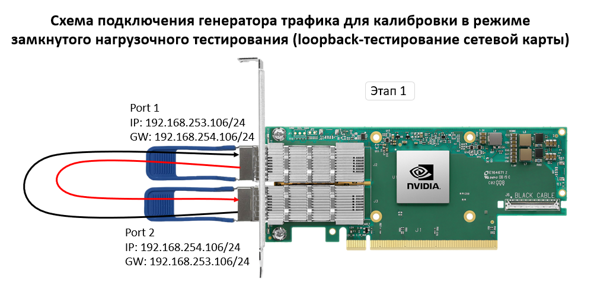
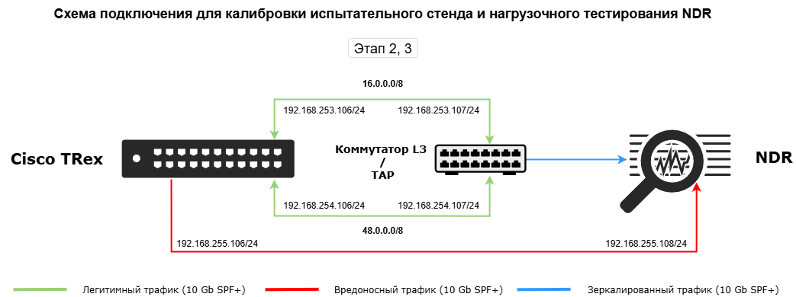
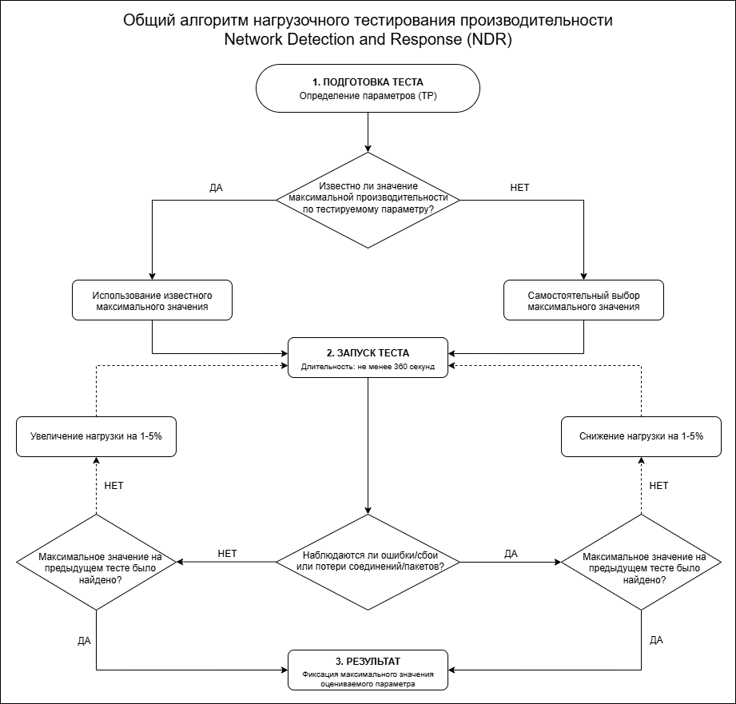
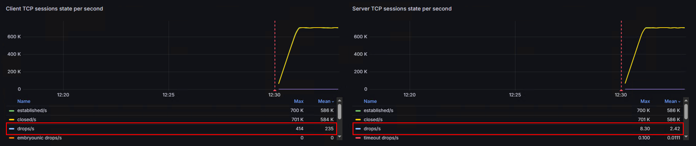

# NDR-Load-Testing-Methodology
Открытая методология по нагрузочному тестированию СЗИ класса Network Detection and Response (NDR)
---

# Оглавление

[Общее положение](#общее-положение)

[Цели методологии](#цели-методологии)

[Настройка испытательного стенда](#настройка-испытательного-стенда)

[Схема подключения испытательного стенда](#схема-подключения-испытательного-стенда)

[Список проводимых тестов](#список-проводимых-тестов)

[Профили трафика](#профили-трафика)

[Общий алгоритм проведения нагрузочного тестирования NDR](#общий-алгоритм-проведения-нагрузочного-тестирования-ndr)

[Оформление результатов нагрузочного тестирования NDR](#оформление-результатов-нагрузочного-тестирования-ndr)

[Режим PCAP](#режим-pcap)

[Тестирование эффективности функций безопасности под нагрузкой](#тестирование-эффективности-функций-безопасности-под-нагрузкой)

[Оформление выводов по результатам нагрузочного тестирования NDR](#оформление-выводов-по-результатам-нагрузочного-тестирования-ndr)

[Приложение](#приложение)

# Общее положение

Данная методология нагрузочного тестирования разработана в соответствии
с международными нормативно-методическими документами, стандартами и
рекомендациями, регулирующими вопросы нагрузочного тестирования и оценки
критериев производительности устройств сетевой безопасности с
соблюдением принципа использования сетевых протоколов передачи данных:

1)  Международный методический документ RFC 9411 от 3 марта 2023 г.
    “[Методика сравнительного анализа производительности устройств
    сетевой безопасности](https://www.rfc-editor.org/rfc/rfc9411.txt)”;

2)  Методология IEEE от 31 октября 1996 г. “[Методология тестирования
    систем обнаружения
    вторжений](https://ieeexplore.ieee.org/document/544350)”;

3)  Техническая публикация NIST от 11 июля 2003 г. “[Обзор проблем при
    тестировании средств обнаружения
    вторжений](https://nvlpubs.nist.gov/nistpubs/Legacy/IR/nistir7007.pdf)”;

4)  Методические документы отечественных и зарубежных компаний (Jet
    Security, Infotecs, TS Solution и другие);

5)  Собственная методика нагрузочного тестирования;

6)  Иные нормативно-методические документы.

Представленная методология рассчитана на проведение тестов
производительности NDR с использованием генератора трафика Cisco TRex,
однако не исключена возможность использования иных средств генерации
трафика.

# Цели методологии

Настоящая методология нагрузочного тестирования Network Detection and
Response (NDR), разработана с целью определения максимальных значений
показателей производительности NDR, а также проверки его функциональных
возможностей и технических характеристик.

# Настройка испытательного стенда

На сервере с генератором трафика необходимо настроить следующие
параметры BIOS:

- Отключить гиперпоточность (Hyperthreading);

- Включить Intel VT-d;

- Включить профиль «Максимальная производительность» или «Низкая
  задержка»;

- Включить SR-IOV (при необходимости).

В grub добавить параметр запуска “GRUB_CMDLINE_LINUX_DEFAULT=”quiet
intel_iommu=on iommu=pt”.

В настройках сетевых интерфейсов генератора трафика необходимо
установить следующие параметры:

1)  Максимальный размер сегмента, анонсируемый при установлении сетевого
    взаимодействия (MSS) – 1460 Байт;

2)  Размер окна приема данных – 65535 Байт;

3)  Начальный размер окна перегрузки (IW) – десятикратное значение MSS
    (14600 Байт);

4)  Время между повторными попытками установления TCP-соединения – 500
    мс;

5)  Количество повторных попыток установления TCP-соединения, прежде чем
    соединение будет сочтено ошибочным и сброшено – 3 попытки;

6)  TCP-соединение – установка TCP-соединения между узлами
    осуществляется в 3 этапа (SYN, SYN/ACK, ACK), завершение
    TCP-соединения осуществляется в 3 (FIN, FIN/ACK, ACK) или в 4 этапа
    (FIN, ACK, FIN, ACK).

Также для достижения максимальной производительности должны быть
настроены системные ограничения для генератора трафика, параметры должны
подбираться в зависимости от аппаратных характеристик.

**Настройки ядра операционной системы /etc/sysctl.conf:**

Исходные данные:

| Параметр                                          | Значение   |
|---------------------------------------------------|------------|
| Целевое количество новых соединений (CC)          | 14 000 000 |
| Целевая пропускная способность (B)                | 200 Гбит/с |
| ОЗУ (RAM)                                         | 256 ГБ     |
| Целевое количество одновременных соединений (CPS) | 680 000    |
| RTT (задержка, наихудший сценарий)                | 40 мс      |
| RTT (типовой локальный стенд)                     | 1 мс       |
| tcp_fin_timeout                                   | 5 с        |
| Размер страницы виртуальной памяти (PAGE_SIZE)    | 4096 байт  |

**Максимальное количество файлов дескриптора.**

*fs.file-max = 20000000*

Максимальное значение fs.file-max рассчитывается по формуле:

$$file\_\max = \frac{\left( mempages*\left( \frac{PAGE\_ SIZE}{1024} \right) \right)}{k} = \frac{\left( \frac{256\ ГБ}{4\ КБ}*\left( \frac{4096\ байт}{1024\ байт} \right) \right)}{10} = \frac{67108864*4}{10} = 26843545$$

где:  
mempages – количество страниц физической памяти;

k – использование не более 10% памяти под структуры файлов (ядро
резервирует не более 10% RAM под структуру файловых дескрипторов. 1
дескриптор ≈ 1 КБ).

**Максимальное количество файлов на каждый процесс.**

*fs.nr_open = 20000000* – должен быть равен
fs.file-max

**Максимальное количество записей TIME_WAIT в хэш-таблице**

*net.ipv4.tcp_max_tw_buckets = 5000000*

Значение tcp_max_tw_buckets рассчитывается по формуле:

$$tcp\_ max\_ tw\_ buckets = CPS*tcp\_ fin\_ timeout + \ коэффициент\_ запаса = 680000*5*150\% \approx 5000000$$

**Переиспользование сокетов из состояния TIME_WAIT для новых исходящих
соединений**

*net.ipv4.tcp_tw_reuse = 0* \# значение 1
плохо влияет на производительность генератора трафика, поэтому 0

**Количество попыток отправить SYN-пакет при установлении нового
соединения (со стороны клиента), если нет ответа**

*net.ipv4.tcp_syn_retries = 3*

**Количество попыток отправить SYN-ACK при установлении соединения (со
стороны сервера), если нет ответного ACK от клиента**

*net.ipv4.tcp_synack_retries = 3*

**Количество попыток передачи данных, после которых ядро проверяет
маршрут к получателю**

*net.ipv4.tcp_retries1 = 3*

**Количество попыток передачи данных, после которых соединение
принудительно разрывается**

*net.ipv4.tcp_retries2 = 8*

**Минимальный, начальный и максимальный размер приемного/отправного
буфера для одного TCP-сокета**

*net.ipv4.tcp_rmem = 4096 33554432 1073741824*

*net.ipv4.tcp_wmem = 4096 33554432 1073741824*

Расчет значений для tcp_rmem и tcp_wmem:

min = 4096 – не может быть меньше страницы памяти;

$$BDP = B*RTT,$$

BDP (Bandwidth-Delay Product) – максимальный объем данных который может
находится в процессе передачи данных;

Локальный стенд ($RTT \approx 1\ мс = 0,001\ с$):

$$BDP = \left( \frac{200*10^{9}}{8}\ байт/с \right)*0,001\ мс = 25\ MiB$$

Худший сценарий ($RTT \approx 40\ мс = 0,04\ с):$

$$BDP = \left( \frac{200*10^{9}}{8}\ байт/с \right)*0,04\ мс = 953,7\ MiB$$

default = 33554432 (32 MiB – с запасом) – должен быть не меньше BDP для
самого быстрого сценария (25 MiB).

max = 1073741824 (1 GiB – небольшой запас, для сети с низкой задержкой в
рамках локального стенда приемлемо) – должен быть не меньше BDP для
худшего сценария (953,7 MiB).

**Глобальные буферы приема/отправки для системного вызова setsockopt**

*net.core.rmem_max = 1073741824* – глобальный
потолок буфера приема по памяти должен быть ≥tcp_rmem max

*net.core.wmem_max = 1073741824* – глобальный
потолок буфера отправки по памяти должен быть ≥tcp_wmem max

**Максимальный объем памяти выделяемый под TCP-соединения в ядре ОС**

*net.ipv4.tcp_mem = 8388608 11184810 16777216*

Параметр tcp_mem рассчитывается по формулам:

$$min = \frac{\max}{2} = \frac{16777216}{2} = 8388608$$

$$pressure = min*коэффициент\_ корректировки = 8388608*1,33 \approx 11184810$$

$$\max = CC*PAGE\_ SIZE*коэффициент\_ запаса = 14000000*4096*120\% = 53,4ГБ\ *120\% \approx 64\ ГБ = 16777216\ байт$$

**Максимальное количество незакрытых сокетов (не утилизированных ядром,
но закрытых приложением)**

*net.ipv4.tcp_max_orphans = 524228*

Каждый orphan-сокет потребляет до 64КБ памяти ядра. Значение 524228
позволяет использовать до 32 ГБ памяти под orphan-сокеты (≈12-13% от 256
ГБ RAM).

**Время, которое сокет проводит в состоянии TIME_WAIT после закрытия**

*net.ipv4.tcp_fin_timeout = 5*

**Функция включения/отключения механизма защиты от SYN-flood атак**

*net.ipv4.tcp_syncookies = 0*

**Определение диапазона локальных портов, которые система может
назначить для исходящих соединений**

*net.ipv4.ip_local_port_range = 1024 65535*

**Максимальный размер очереди готовых соединений (уже после установления
соединения)**

*net.core.somaxconn = 524288* – максимально
допустимое значение в ядре Linux

**Максимальный размер очереди полуоткрытых соединений**

*net.ipv4.tcp_max_syn_backlog = 524288* –
должно быть ≥ somaxconn

**Максимальный размер очереди пакетов на уровне сетевого драйвера**

*net.core.netdev_max_backlog = 1000000*

Параметр max_backlog рассчитывается по формуле:

$$\max\_ backlog = PPS*время\_ накопления = 50000000\ пак*0,2\ с = 1000000$$

**Настройки лимитов /etc/security/limits.conf:**

\* soft nofile 20000000

\* hard nofile 20000000

user soft nofile 20000000

user hard nofile 20000000

root soft nofile 20000000

root hard nofile 20000000

Аппаратные характеристики сервера генератора трафика и его программная
составляющая, должны быть равны или превышать характеристики
тестируемого NDR. При необходимости допускается создание кластера из
нескольких серверов с генераторами трафика. Запрещается использованием
виртуальных машин для развертывания генератора трафика, за исключением
тестирования СЗИ полностью в виртуальной среде.

Настройка конфигураций тестируемого NDR должна осуществляться
исключительно в соответствии с документацией на средство защиты (должны
использоваться рекомендуемые производителем параметры настройки NDR).

При работе NDR в различных режимах, необходимо проводить тестирование с
каждым из этих режимов.

В случае если производитель не предоставляет рекомендуемые настройки
параметров NDR, то тестировщик самостоятельно реализует его минимальную
конфигурацию.

Перед началом проведения тестов производительности тестировщик обязан
убедиться в корректности настройки и функционировании всех компонентов
стенда, а также произвести тестовый запуск генерации трафика.

# Схема подключения испытательного стенда

Нагрузочное тестирование проводится в три этапа:

1)  Калибровка генератора трафика в режиме замкнутого нагрузочного
    тестирования;

2)  Калибровка испытательного стенда (нагрузочное тестирование NDR без
    включенных функций безопасности с включенным журналированием всего
    трафика);

3)  Нагрузочное тестирование
    NDR с включенными функциями безопасности.

# Список проводимых тестов

**В рамках проводимых испытаний определена нагрузка в виде** трафика
уровня приложений (EMIX-трафик L7-уровня).

**Нагрузочное тестирование NDR проводилось в 4-х режимах работы:**

1)  Анализ трафика в режиме PCAP;

2)  Анализ NetFlow-трафика;

3)  Анализ трафика в режиме DPDK;

4)  Анализ трафика в режиме ERSPAN.

**В рамках проводимых испытаний определены следующие виды тестов:**

1)  Калибровка генератора трафика в режиме замкнутого нагрузочного
    тестирования;

2)  Калибровка испытательного стенда (нагрузочное тестирование NDR без
    включенных функций безопасности (правил фильтрации) с включенным
    журналированием);

3)  Нагрузочное тестирование NDR с включенными функциями безопасности
    (тестирование производительности):

    1.  IDS (25/50/100 сигнатур) + журналирование нешифрованного
        трафика;

    2.  IDS (25/50/100 сигнатур) + журналирование шифрованного трафика;

    3.  IDS (25/50/100 сигнатур) + журналирование шифрованного и
        нешифрованного трафика.

4)  Нагрузочное тестирование функций безопасности NDR (тестирование
    эффективности) на:

    1.  Обнаружение признаков компьютерных атак;

    2.  Выявление вредоносного ПО;

    3.  Выявления фактов сетевой разведки.

**Тесты с атаками включают в себя такие вредоносные воздействия как:**

1)  Атаки сетевого сканирования;

2)  Атаки проникновения, связанные с эксплуатацией уязвимостей
    информационной (автоматизированной) системы;

3)  Атаки, направленные на отказ в обслуживании;

4)  Атаки перебора аутентификационных данных.

Для тестирования NDR на выявление признаков компьютерных атак и
вредоносного программного обеспечения под нагрузкой должен
использоваться базовый набор правил IDS предоставляемый производителем.

Каждая функция безопасности NDR должна проходить тестирование как по
отдельности, так и в комбинации с другими функциями безопасности.

Тестирование должно проводиться с включенным журналированием всего
трафика в любом из тестируемых режимов.

**Ограничения и допущения к проведению нагрузочного тестирования
(критерии выполнения тестов производительности):**

1)  Процент загрузки ЦП NDR – не более 80% (в том числе и генератора
    трафика);

Загрузка ЦП считается как среднее значение по всем ядрам процессоров по
следующей формуле:

$overall_{usage} = \ \frac{total_{diff} - \ idle_{diff}}{total_{diff}}*100$,

Где:

total_diff – сумма всех показателей одного ядра во второй выборке;

idle_diff – разница времени простоя между второй и первой выборкой.

Значения берутся из файла /proc/stat. В данном файле есть общее время по
всем ядрам (значение cpu), а также по отдельным ядрам (cpu0, cpu1, cpu2
…). [Период выборки 1
секунда](https://www.researchgate.net/publication/322152452_Analysis_of_CPU_Usage_Data_Properties_and_their_possible_impact_on_Performance_Monitoring).

**Пример расчета:**

Первый замер для cpu (в момент времени T0):

cpu 5000000 1000 2000000 3000000 500000 100000 50000 10000 5000 1000

Значения по индексам:

- \[0\] user = 5 000 000 – время выполнения пользовательских процессов;

- \[1\] nice = 1 000 – время выполнения приоритетных пользовательских
  процессов;

- \[2\] system = 2 000 000 – время выполнения системных вызовов ядра;

- \[3\] idle = 3 000 000 – время полного простоя процессора (ядра);

- \[4\] iowait = 500 000 – время ожидания ввода-вывода;

- \[5\] irq = 100 000 – время обработки аппаратных прерываний;

- \[6\] softirq = 50 000 – время обработки программных прерываний;

- \[7\] steal = 10 000 – время, потраченное гипервизором;

- \[8\] guest = 5 000 – время выполнения гостевой ОС;

- \[9\] guest_nice = 1 000 – приоритетное время гостевой ОС.

Второй замер для cpu (через 1 секунду, в момент времени T1):

cpu 5001000 1000 2001000 3000100 500100 100010 50050 10010 5005 1001

**Этап 1.**

Расчет времени простоя ядра (idle):

$$idle = idle + iowait$$

Первый замер:

$$idle_{1} = 3000000 - 500000 = 3500000$$

Второй замер:

$$idle_{2} = 3000100 - 500100 = 3500200$$

**Этап 2.**

Расчет общего времени работы cpu по всем показателям (total1):

$$total = user + nice + system + idle + iowait + irq + softirq + steal + guest + guest\_ nice$$

Первый замер:

$$total_{1} = 5000000 + 1000 + 2000000 + 3000000 + 500000 + 100000 + 50000 + 10000 + 5000 + 1000 = 10667000$$

Второй замер:

$$total_{2} = 5001000 + 1000 + 2001000 + 3000100 + 500100 + 100010 + 50050 + 10010 + 5005 + 1001 = 10669276$$

**Этап 3.**

Вычисление разницы замеров (idle_diff, total_diff):

$$idle_{diff} = idle_{2} - idle_{1} = 3500200 - 3500000 = 200$$

$$total_{diff} = total_{2} - total_{1} = 10669276 - 10667000 = 2276$$

**Этап 4.**

Вычисление загрузки cpu:

$$Загрузка_{cpu} = \frac{total_{diff} - idle_{diff}}{total_{diff}}*100 = \frac{\sum_{i = 0}^{n - 1}{total_{diff_{i}} - idle_{diff_{i}}}}{\sum_{i = 0}^{n - 1}{total_{diff_{i}}}}*100 = \frac{2276 - 200}{2276}*100 = 91,21\%$$

На данном этапе была получена общая загрузка ЦП по всем ядрам
процессоров.

Можно самостоятельно посчитать загрузку каждого ядра процессора (cpu0,
cpu1, ….), затем вычислить средневзвешенную сумму, либо как представлено
в примере, посчитать общую загрузку ЦП по всем ядрам процессоров с
использованием значений параметра cpu из файла /proc/stat.

2)  Длительность одного теста – 1 минута (60 секунд – период нарастания
    нагрузки) + 5 минут (300 секунд – период выдержки целевого значения)
    = 6 минут (360 секунд);

3)  Процент использования оперативной (RAM) и swap памяти NDR – не более
    80% (в том числе и генератора трафика);

4)  Допустимое количество потерь трафика (байт) на физических и
    логических интерфейсах – не более 0,001% (dpdk_ifconfig);

5)  Допустимое количество потерь пакетов на физических и логических
    интерфейсах – не более 0,001% (dpdk_ifconfig);

6)  Перед каждым запуском нагрузочного теста необходимо очищать
    лог-файлы тестируемого устройства (если включено журналирование);

7)  После проведения каждого теста необходимо перезагружать тестируемое
    устройство и выдерживать период восстановления (не запускать
    следующий тест установленное время) равным 2-3 минутам (при
    длительной загрузке сервера, можно пренебречь его перезагрузкой,
    достаточно будет выдержать период восстановления после каждого
    теста);

8)  В момент проведения теста не должно быть зафиксировано ошибок о
    потерях трафика и иных ошибок, связанных с обработкой трафика в
    файле probe.log;

9)  Выбранный вредоносный дамп трафика для проведения тестирования
    должен обнаруживаться подсистемой IDS;

10) После отправки вредоносных пакетов для корректного завершения
    анализа трафика выдерживалось время ожидания 5 минут перед тем, как
    запустить новый дамп.

Также в ходе тестирования необходимо контролировать корректность работы
всех функций NDR (например, журналирования, веб-интерфейса управления,
мониторинга и других функций). Корректность функционирования функций NDR
не должна быть нарушена под нагрузкой при проведении нагрузочного теста.

Генерация трафика на тестируемый NDR должна осуществляться с разных
IP-адресов и по возможности с разных сетевых интерфейсов, с целью
предотвращения переполнения таблицы состояний на тестируемом устройстве.

Процессы генератора трафика должны быть привязаны только к тем ядрам
процессора, который отвечает за используемую сетевую карту для генерации
трафика (в случае наличия у используемого сервера под генератор трафика
NUMA технологии – 2 и более процессоров. При использовании NUMA
технологии каждый процессор обрабатывает трафик на своей сетевой карте).

Для просмотра NUMA ноды сетевой карты, выполнить команду:

“**cat** **/sys/class/net/eth0/device/numa_node**”

где:

eth0 – название сетевого интерфейса.

Для просмотра NUMA групп, выполнить команду:

“**lscpu**”

Команда покажет какие ядра в какую NUMA-ноду входят.

Устройство, зеркалирующее трафик, должно быть подключено к сетевой карте
тестируемого устройства, которая расположена на одной NUMA ноде, не
допускается подключение 2-х каналов передачи данных от устройства,
зеркалирующего трафик, к разным сетевым картам, расположенным на разных
NUMA нодах тестируемого устройства.

# Профили трафика

Для EMIX-трафика используется следующие протоколы уровня приложений в
процентном соотношении от общего объема трафика (допустимо использование
собственного профиля трафика EMIX):

<table>
<colgroup>
<col style="width: 24%" />
<col style="width: 25%" />
<col style="width: 25%" />
<col style="width: 25%" />
</colgroup>
<thead>
<tr class="header">
<th><strong>Трафик</strong></th>
<th><strong>Размер одного соединения</strong></th>
<th><strong>CPS</strong></th>
<th><strong>% от общего трафика</strong></th>
</tr>
</thead>
<tbody>
<tr class="odd">
<td>HTTPS</td>
<td>86,2 kB</td>
<td>108</td>
<td>54</td>
</tr>
<tr class="even">
<td>SSH</td>
<td>3,71 kB</td>
<td>40</td>
<td>20</td>
</tr>
<tr class="odd">
<td>HTTP_GET 
(получение данных)</td>
<td>35,3 kB</td>
<td>12</td>
<td>6</td>
</tr>
<tr class="even">
<td>RDP</td>
<td>8,23 MB</td>
<td>10</td>
<td>5</td>
</tr>
<tr class="odd">
<td>UDP</td>
<td>2,43 MB</td>
<td>10</td>
<td>5</td>
</tr>
<tr class="even">
<td>SMTP</td>
<td>4,39 kB</td>
<td>6</td>
<td>3</td>
</tr>
<tr class="odd">
<td>HTTP_POST 
(загрузка данных)</td>
<td>45,4 kB</td>
<td>4</td>
<td>2</td>
</tr>
<tr class="even">
<td>SNMP</td>
<td>47,8 kB</td>
<td>2</td>
<td>1</td>
</tr>
<tr class="odd">
<td>POP3</td>
<td>4,48 kB</td>
<td>2</td>
<td>1</td>
</tr>
<tr class="even">
<td>DNS</td>
<td>78,0 B</td>
<td>2</td>
<td>1</td>
</tr>
<tr class="odd">
<td>SMB</td>
<td>62,4 kB</td>
<td>2</td>
<td>1</td>
</tr>
<tr class="even">
<td>FTP</td>
<td>1,43 kB</td>
<td>2</td>
<td>1</td>
</tr>
<tr class="odd">
<td><strong>Всего:</strong></td>
<td><strong>11,0 МБ</strong></td>
<td><strong>200</strong></td>
<td><strong>100</strong></td>
</tr>
</tbody>
</table>

# 

# Общий алгоритм проведения нагрузочного тестирования NDR

Нагрузочное тестирование по определению максимальных значений
показателей производительности NDR производится в соответствии с
представленным алгоритмом.

# Оформление результатов нагрузочного тестирования NDR

По итогу проведенных испытаний заполняются таблицы результатов
нагрузочного тестирования, в которых определены максимальные значения
тестируемых показателей производительности, удовлетворяющие всем
предъявляемым требованиям к проведению нагрузочного тестирования.

– Оцениваемая метрика; – Ограничивающий показатель производительности; –
Тестирование не проводилось.

| Показатель производительности                                                                                               | Максимальная пропускная способность (TP) |         |      |        |
|-----------------------------------------------------------------------------------------------------------------------------|------------------------------------------|---------|------|--------|
|                                                                                                                             | PCAP                                     | NetFlow | DPDK | ERSPAN |
| Калибровка испытательного стенда (без включенных функций безопасности (политик) с включенным журналированием всего трафика) |                                          |         |      |        |
| Множитель трафика                                                                                                           | 8                                        |         |      |        |
| Количество пакетов в секунду (PPS), тыс. пак/сек                                                                            | 386                                      |         |      |        |
| Пропускная способность (TP), Гбит/сек                                                                                       | 2,07                                     |         |      |        |
| Загрузка ЦП, %                                                                                                              | 15,75                                    |         |      |        |
| Максимальное использование RAM-памяти, %                                                                                    | 11,62                                    |         |      |        |
| Максимальное использование SWAP-памяти, %                                                                                   | 0                                        |         |      |        |
| Пропускная способность записи на диск, Мб/с                                                                                 | 317                                      |         |      |        |
| Задержка при записи на диск, мс                                                                                             | 2,43                                     |         |      |        |
| Потери пакетов (dpdk_ifconfig), % / кол                                                                                     | 0                                        |         |      |        |
| Потери трафика (dpdk_ifconfig), % / байт                                                                                    | 0                                        |         |      |        |
| Время выполнения теста, сек                                                                                                 | 360                                      |         |      |        |

## 

# Режим PCAP

| Показатель производительности                                                 | Максимальная пропускная способность (TP) |     |     |                    |     |     |             |     |     |
|-------------------------------------------------------------------------------|------------------------------------------|-----|-----|--------------------|-----|-----|-------------|-----|-----|
|                                                                               | Нешифрованный трафик                     |     |     | Шифрованный трафик |     |     | Весь трафик |     |     |
| Нагрузочное тестирование с включенными функциями безопасности: **режим PCAP** |                                          |     |     |                    |     |     |             |     |     |
| Количество сигнатур                                                           | 25                                       |     |     |                    |     |     |             |     |     |
| Множитель трафика                                                             | 8                                        |     |     |                    |     |     |             |     |     |
| Количество пакетов в секунду (PPS), тыс. пак/сек                              | 387                                      |     |     |                    |     |     |             |     |     |
| Пропускная способность (TP), Гбит/сек                                         | 2,07                                     |     |     |                    |     |     |             |     |     |
| Загрузка ЦП, %                                                                | 17,23                                    |     |     |                    |     |     |             |     |     |
| Максимальное использование RAM-памяти, %                                      | 11,41                                    |     |     |                    |     |     |             |     |     |
| Максимальное использование SWAP-памяти, %                                     | 0                                        |     |     |                    |     |     |             |     |     |
| Пропускная способность записи на диск, Мб/с                                   | 266                                      |     |     |                    |     |     |             |     |     |
| Задержка при записи на диск, мс                                               | 2,56                                     |     |     |                    |     |     |             |     |     |
| Потери пакетов (dpdk_ifconfig), % / кол                                       | 0                                        |     |     |                    |     |     |             |     |     |
| Потери трафика (dpdk_ifconfig), % / байт                                      | 0                                        |     |     |                    |     |     |             |     |     |
| Время выполнения теста, сек                                                   | 360                                      |     |     |                    |     |     |             |     |     |

Аналогичным образом заполняются таблицы для тестов калибровки и
тестирования NDR с иными включенными функциями безопасности (в иной
конфигурации / в ином режиме работы).

# Тестирование эффективности функций безопасности под нагрузкой

По результатам тестирования функций безопасности NDR на выявление и
блокирование признаков компьютерных атак и вредоносного программного
обеспечения, также заполняется сводная таблица.

| Режимы работы                                                      | PCAP | NetFlow |     | DPDK |     | ERSPAN |     | PCAP | NetFlow |     | DPDK |     | ERSPAN |     |
|--------------------------------------------------------------------|------|---------|-----|------|-----|--------|-----|------|---------|-----|------|-----|--------|-----|
| Количество сигнатур                                                | 100  |         |     |      |     |        |     |      |         |     |      |     |        |     |
| Процент легитимного трафика от максимальной пропускной способности | 50%  |         |     |      |     |        |     | 90%  |         |     |      |     |        |     |
| Выявлено и заблокировано атак                                      | 114  |         |     |      | 114 |        |     | 94   |         |     |      | 84  |        |     |
| Пропущено атак                                                     | 76   |         |     |      | 76  |        |     | 96   |         |     |      | 106 |        |     |
| Всего отправлено атак                                              | 190  |         |     |      | 190 |        |     | 190  |         |     |      | 190 |        |     |

В завершение приводится таблица, отражающая максимальные значения
тестируемых показателей производительности, при которых NDR справляется
с блокировкой всех отправленных атак, при этом потери трафика
отсутствуют полностью, либо несущественны.

<table>
<colgroup>
<col style="width: 39%" />
<col style="width: 7%" />
<col style="width: 0%" />
<col style="width: 7%" />
<col style="width: 15%" />
<col style="width: 0%" />
<col style="width: 15%" />
<col style="width: 15%" />
</colgroup>
<thead>
<tr class="header">
<th rowspan="2">Показатели производительности</th>
<th colspan="7">Максимальная пропускная способность (TP)</th>
</tr>
<tr class="odd">
<th colspan="7">EMIX-трафика</th>
</tr>
</thead>
<tbody>
<tr class="odd">
<td colspan="8">Тестирование функций безопасности</td>
</tr>
<tr class="even">
<td>Вердикт</td>
<td colspan="7">Вредоносный сетевой трафик</td>
</tr>
<tr class="odd">
<td rowspan="2"></td>
<td colspan="3">PCAP</td>
<td rowspan="2">NetFlow</td>
<td colspan="2" rowspan="2">DPDK</td>
<td rowspan="2">ERSPAN</td>
</tr>
<tr class="even">
<td>1 Гбит/с</td>
<td colspan="2">10 Гбит/с</td>
</tr>
<tr class="odd">
<td>Количество сигнатур</td>
<td colspan="7">100</td>
</tr>
<tr class="even">
<td>Множитель трафика</td>
<td colspan="2">2</td>
<td></td>
<td colspan="2"></td>
<td></td>
<td></td>
</tr>
<tr class="odd">
<td>Пропускная способность (TP), Гбит/сек</td>
<td colspan="2">0,535</td>
<td></td>
<td colspan="2"></td>
<td></td>
<td></td>
</tr>
<tr class="even">
<td>Количество отправленных пакетов генератором, тыс. пак</td>
<td colspan="2">27 700</td>
<td></td>
<td colspan="2"></td>
<td></td>
<td></td>
</tr>
<tr class="odd">
<td>Количество принятых пакетов NDR, тыс. пак (интерфейс_1 /
интерфейс_2)</td>
<td colspan="2">14 344 / 
14 195</td>
<td></td>
<td colspan="2"></td>
<td></td>
<td></td>
</tr>
<tr class="even">
<td>Объём трафика, отправленного генератором, Гб</td>
<td colspan="2">17,3</td>
<td></td>
<td colspan="2"></td>
<td></td>
<td></td>
</tr>
<tr class="odd">
<td>Объём трафика, принятого NDR, Гб (интерфейс_1 / интерфейс_2)</td>
<td colspan="2">9,33 / 9,15</td>
<td></td>
<td colspan="2"></td>
<td></td>
<td></td>
</tr>
<tr class="even">
<td>Пропускная способность записи на диск, Мб/с</td>
<td colspan="2">106</td>
<td></td>
<td colspan="2"></td>
<td></td>
<td></td>
</tr>
<tr class="odd">
<td>Задержка при записи на диск, мс</td>
<td colspan="2">2,53</td>
<td></td>
<td colspan="2"></td>
<td></td>
<td></td>
</tr>
<tr class="even">
<td>Средняя длинна очереди запросов к диску, кол/с</td>
<td colspan="2">0,19</td>
<td></td>
<td colspan="2"></td>
<td></td>
<td></td>
</tr>
<tr class="odd">
<td>Выявлено и заблокировано</td>
<td colspan="2">190</td>
<td></td>
<td colspan="2"></td>
<td></td>
<td></td>
</tr>
<tr class="even">
<td>Пропущено</td>
<td colspan="2">0</td>
<td></td>
<td colspan="2"></td>
<td></td>
<td></td>
</tr>
<tr class="odd">
<td>Всего отправлено</td>
<td colspan="2">190</td>
<td></td>
<td colspan="2"></td>
<td></td>
<td></td>
</tr>
</tbody>
</table>

# Оформление выводов по результатам нагрузочного тестирования NDR

По результатам нагрузочного тестирования и анализа полученных данных
делаются выводы о соответствии/несоответствии заявленных производителем
характеристик, а также предоставляется подробная информация (в виде
скриншотов, схем, описания, диаграмм и в ином представлении) о
выявленных проблемах.

**В ходе проведенных испытаний были получены следующие результаты:**

1)  …;

Рисунок 3 – Ошибки установления соединений (4КБ CPS)

2)  …;

3)  …;

# Приложение
